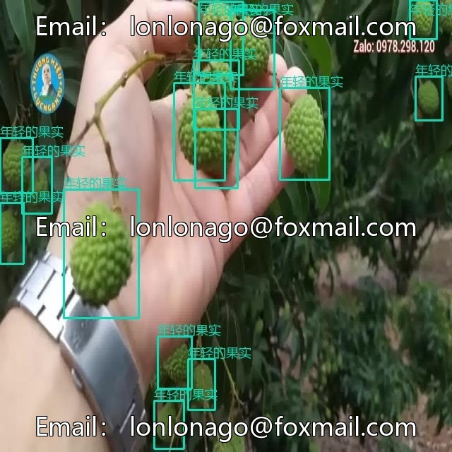
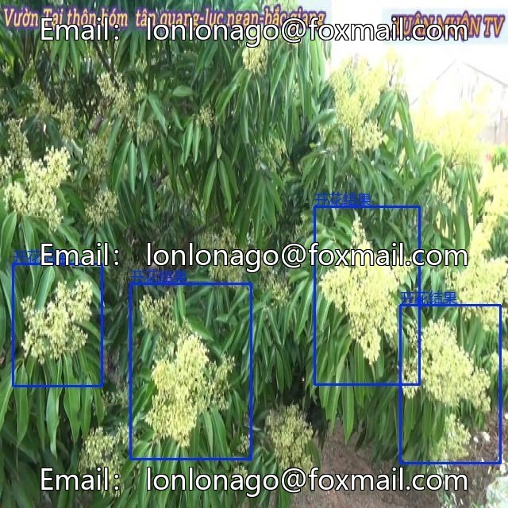
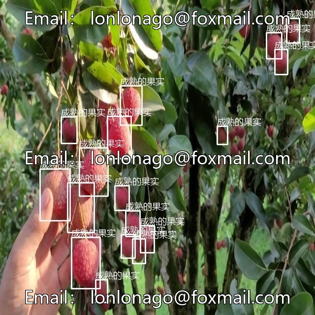
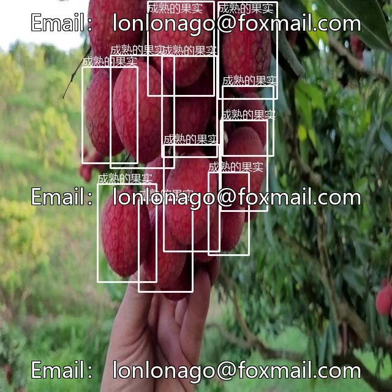
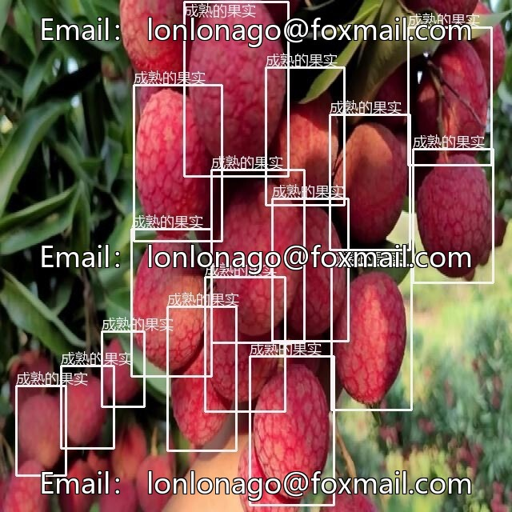

# Intelligent Agriculture Lychee Maturity Recognition Dataset, Issue 10646, includes the color of lychee fruits.

## Body

Intelligent Agriculture Lychee Maturity Recognition Dataset, Issue 10646, includes the recognition of lychee fruit color and maturity, suitable for agricultural intelligent research and application development.

Dataset Content
- Total number of images: 1005
- Categories: Unripe, Half-ripe, Ripe
- Format: Yolo+VOC
- Annotation: Professional team annotation, bounding boxes closely adhere to the fruit, clear classification and noise low labels
- Scenes: Natural light, different angles, slight occlusion, background changes, etc., real field scenes
- Scale: Approximately 1000 effective samples, balanced category distribution, suitable for model training and evaluation

Supports the training of deep learning models, achieving automatic fruit sorting and quality monitoring. It can be used in scenarios such as agricultural automation sorting, supply chain quality control, scientific research and algorithm validation.

Virtual materials, once sold, are non-refundable.
Interested friends, click "I want" to proceed.

## Images

## Payment

Here is a pay link on Stripe ( https://buy.stripe.com/3cs8yP7sY87d0vu9AB ). Please contact me lonlonago@foxmail.com after funding $89, and I will send you a complete data files , thank you!

